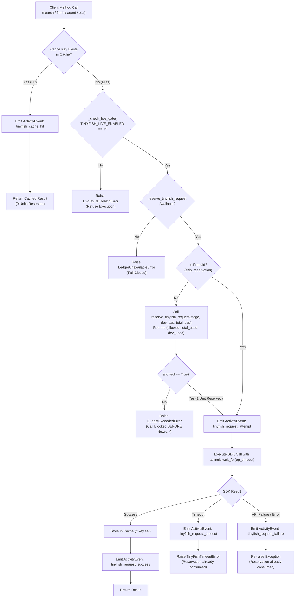

# TinyFish Client Architecture & Budget Gate Specification

This document details the design, budget containment mechanisms, outbound API surface, integration contracts, and offline test suite for `backend/app/tinyfish_client.py`.

---

## 1. Overview & System Purpose

In the DepShield architecture, `backend/app/tinyfish_client.py` serves as the **exclusive gateway** for all outbound TinyFish network requests. Because every API request consumes account balance at an observed rate of **$0.25 / request**, unmetered calls, SDK retries, or background polling loops could rapidly deplete the hackathon allocation ($16 total credit).

The client enforces a **zero-leakage, fail-closed budget gate**:
- Real outbound requests are blocked unless explicitly unlocked (`TINYFISH_LIVE_ENABLED=1`).
- Cache hits cost **0 request units**.
- Exactly **1 request unit** is reserved in the ledger before any normal outbound call is dispatched via `_call()`.
- `_check_live_gate()` is ALWAYS executed before any outbound request.
- `_call()` has no `skip_reservation` parameter and always reserves. Internal prepaid operations use private `_call_prepaid()` which routes through shared `_execute()`.
- All requests have timeouts (120s for `agent_run` and `research_queue`, 30s for other operations) and log an `ActivityEvent`.
- SDK-level automatic retries are explicitly suppressed (`max_retries=0`), and client raises `RuntimeError` immediately if `max_retries=0` is unsupported.
- Research polling is capped at **3 status polls max**, stopping early on `COMPLETED`, `FAILED`, `CANCELLED`, or `TIMED_OUT`.
- Demo monitors perform **create + pause** (2 units total) and reserve both units up front via `_reserve_budget`. If the second reservation is refused, `run_demo_monitor` refuses to create the monitor. If pause fails, raises `MonitorPauseError` that includes the `monitor_id`.
- `skip_reservation` is strictly non-public. Public methods `create_monitor`, `pause_monitor`, and `pause_topic_monitor` do not permit callers to bypass budget reservation.

---

## 2. Request Flow & Budget Gate Pipeline



---

## 3. Budget Caps & Financial Model

| Parameter | Value | Description |
| :--- | :--- | :--- |
| **Development Cap** | `48 units` ($12.00) | Hard limit for local development, test sweeps, and smoke verification. |
| **Total Cap** | `64 units` ($16.00) | Absolute account cap across all stages. |
| **Reserved Demo Margin**| `16 units` ($4.00) | Reserved strictly for final demonstration evaluation. |
| **Request Cost** | `$0.25 / request` | Every outbound call (search, fetch, agent, poll, monitor) is accounted at this rate. |
| **Stage Resolution** | Env var `TINYFISH_BUDGET_STAGE` | Defaults to `"development"`. Only Ansh can promote to `"production"`. |
| **Live Gate** | Env var `TINYFISH_LIVE_ENABLED` | Defaults to `0`. Must be strictly `"1"` for real network calls. |

---

## 4. Outbound API Surface & Methods

All outbound methods are asynchronous and defined on `TinyFishClient`:

### 1. `search(query: str, **kwargs)`
- **SDK Target:** `sdk.search.query(query=..., **kwargs)`
- **Timeout:** 30s
- **Cache Key:** `search:<normalized_lower_query>`
- **Cost:** 0 units on cache hit, 1 unit on outbound call.

### 2. `fetch(urls: Union[str, List[str]], **kwargs)`
- **SDK Target:** `sdk.fetch.get_contents(urls=..., **kwargs)`
- **Timeout:** 30s
- **Cache Key:** `fetch:<normalized_urls>`
- **Cost:** 0 units on cache hit, 1 unit on outbound call.

### 3. `run_agent(goal: str, url: str, **kwargs)`
- **SDK Target:** `sdk.agent.run(goal=..., url=..., **kwargs)`
- **Timeout:** 120s (`AGENT_TIMEOUT_SEC`)
- **Cost:** 1 unit per execution.

### 4. `create_monitor(type, config, schedule_cron, **kwargs)`
- **SDK Target:** `sdk.monitors.create(...)`
- **Timeout:** 30s
- **Cost:** 1 unit per creation.
- **Safety:** Rejects `skip_reservation` if passed by caller (raises `TypeError`).

### 5. `run_monitor(monitor_id: str, **kwargs)`
- **SDK Target:** `sdk.monitors.run(monitor_id=...)`
- **Timeout:** 30s
- **Cost:** 1 unit per run.

### 6. `pause_monitor(monitor_id: str, **kwargs)` & `pause_topic_monitor(...)`
- **SDK Target:** `sdk.monitors.pause(monitor_id=...)`
- **Timeout:** 30s
- **Cost:** 1 unit per pause.
- **Safety:** Rejects `skip_reservation` if passed by caller (raises `TypeError`).

### 7. `run_demo_monitor(type, config, schedule_cron, **kwargs)`
- **Workflow:** 
  1. Reserves two units up front via `_reserve_budget("demo_monitor_create")` and `_reserve_budget("demo_monitor_pause")`.
  2. If the second reservation is refused (budget cap reached), does **not** create the monitor.
  3. Uses internal `_create_monitor_prepaid` to create monitor (runs `_check_live_gate`).
  4. Uses internal `_pause_monitor_prepaid` to pause monitor (runs `_check_live_gate`).
  5. If pause fails, raises `MonitorPauseError` that explicitly includes `monitor_id`.
- **Cost:** Exactly 2 units reserved up front. Prevents unattended cron execution from incurring recurring charges.

### 8. `queue_research(query: str, **kwargs)` & `poll_research(run_id: str)`
- **SDK Targets:** `sdk.research.queue(...)` (120s timeout) and `sdk.research.get(run_id=...)` (30s timeout)
- **High-level wrapper:** `run_research(query, max_polls=3, poll_interval=...)`
- **Hard Guard:** Maximum **3 status polls**. Normalizes status via `str(getattr(status, "value", status)).upper()`. Stops immediately once terminal status (`COMPLETED`, `FAILED`, `CANCELLED`, `TIMED_OUT`) is reached.
- **Cost:** 1 unit for queuing + up to 3 units for polling (1 to 4 units total).

### 9. `wallet_balance()`
- **SDK Target:** `sdk.wallet.get()`
- **Timeout:** 30s
- **Protection:** Must **never** be triggered automatically, in health checks, or in polling routines. Can only be invoked manually.

---

## 5. Anti-Leakage Guards

1. **Suppression of Hidden SDK Retries:**
   The TinyFish Python SDK defaults to `max_retries=2` inside `AsyncTinyFish`. We instantiate the client with `max_retries=0`. If the installed SDK lacks support for `max_retries=0`, `TinyFishClient.get_sdk_client()` raises a `RuntimeError` immediately rather than silently falling back.
2. **Fail-Closed Gate Separation (`_check_live_gate`):**
   `_check_live_gate()` ensures no request ever reaches the network unless `TINYFISH_LIVE_ENABLED=1` and `reserve_fn` is available. `_call()` always runs this check prior to any outbound attempt, regardless of whether reservation is normal or prepaid.
3. **Strict Non-Public Reservation Bypass:**
   `skip_reservation` is completely excluded from public method signatures. Passing it to `create_monitor`, `pause_monitor`, or `pause_topic_monitor` raises `TypeError`.
4. **Hard Cap Enforced Pre-Call:**
   The ledger reservation happens before any SDK call is made. If the ledger returns `allowed = False`, `BudgetExceededError` is raised immediately without invoking the SDK.
5. **Demo Monitor Two-Unit Gate:**
   `run_demo_monitor` reserves two units up front before creating the monitor. If the second reservation is refused, no monitor is created.

---

## 6. Shared Contracts with Team

### Contract 1: SQLite Budget Ledger (Ansh)
- **Module:** `backend/app/db.py`
- **Function Signature:**
  ```python
  def reserve_tinyfish_request(stage: str, development_cap: int, total_cap: int) -> tuple[bool, int, int]:
      """
      Returns: (allowed: bool, total_used: int, development_used: int)
      """
  ```
- **Requirements:** Must execute atomic increment in SQLite. Returns `(allowed, total_used, development_used)`. Plain boolean `allowed` is also tolerated for backwards compatibility.

### Contract 2: Activity Event Model (Ansh)
- **Module:** `backend/app/models.py`
- **Model Signature:**
  ```python
  class ActivityEvent(BaseModel):
      event_type: str
      details: dict
      timestamp: str  # ISO-8601 UTC
  ```
- **Current Client Fallback:** If `models.py` is absent, `tinyfish_client.py` provides an internal dataclass with equivalent fields.

---

## 7. Offline Test Suite Verification

All 19 acceptance tests in `backend/tests/test_tinyfish_client.py` run offline using a `FakeLedger` and mocked SDK.
